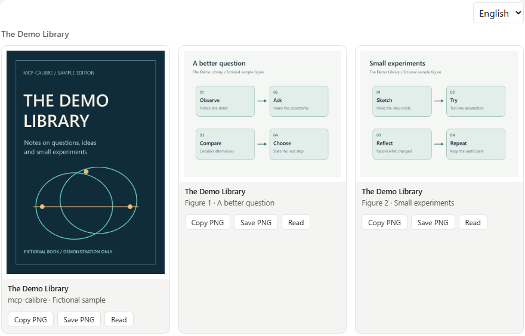
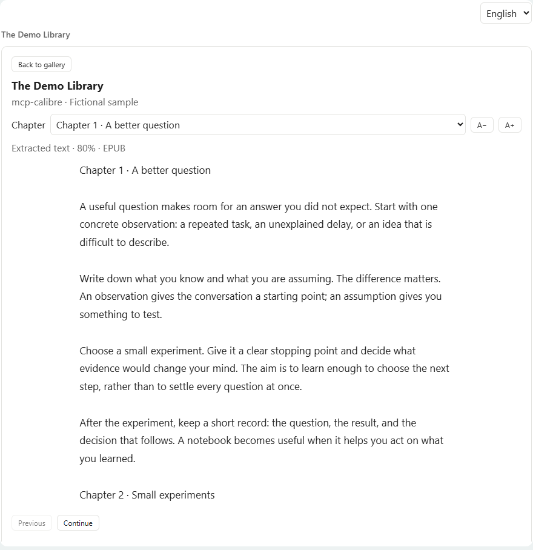
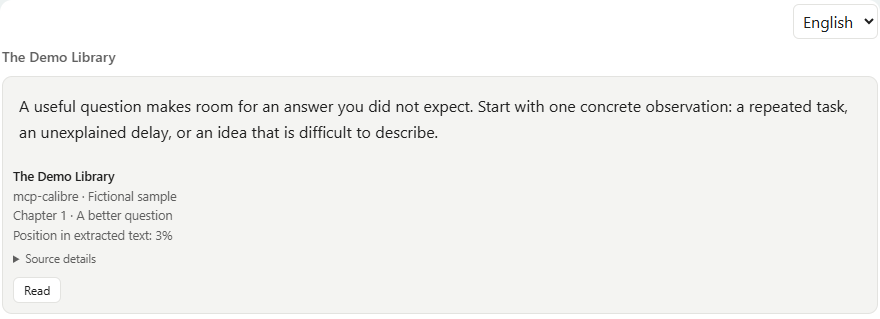

# Reading and images in the chat

[← README](../../README.md) · [Installation](installation.md) · [Tweaking and under the hood](tweaking.md) · **Reading and images** · [Skills](skills.md) · [FAQ](faq.md) · [Performance](performance.md)

🇬🇧 English · [🇮🇹 Italiano](../it/reading-and-images.md)

Consult your own books directly inside the conversation: open covers and figures, inspect a diagram,
read a chapter, or view an exact passage with its source. These controls are for the user. The assistant
and companion skills continue to gather evidence through the normal search/read tools.

## A quick tour

1. Ask to see a book's cover or a relevant figure.
2. Click an image to enlarge it; use Ctrl + wheel to inspect the details.
3. Press **Read** to consult the extracted text, select a chapter and continue reading.
4. Explicitly ask for an exact passage display when you want a quotation with its source.

The screenshots below render the real `gallery.html` in a simulated MCP Apps host. **The Demo Library**,
its cover, figures and text are fictional examples created for this documentation, not a published book.
A real client may use different framing or restrict clipboard, downloads and focus events.

## Showing images in the chat



Images returned by an ordinary MCP tool reach the model, but most clients show them only inside the folded
tool-call block, and the model cannot reuse them in files. `calibre_show_images` displays covers and figures
**to the user, inline in the conversation**, using the official MCP Apps extension (SEP-1865):

- the tool declares an interface (`_meta.ui.resourceUri = ui://calibre-mcp/gallery`), a self-contained HTML
  gallery that the client renders in a sandboxed frame inside the chat;
- the images travel in `structuredContent`, which goes to the gallery and **not into the model's context**:
  showing images costs no model tokens, and the model receives only a short text summary;
- everything stays read-only: no files are written, the gallery has no network access (images are
  `data:` URIs, allowed by the restrictive default CSP of the spec), and nothing leaves the machine.

Example request to the assistant: "show me the covers of 1168 and 1164", or "show figure s3-2 of 1164".

| Action | Gesture |
|---|---|
| Switch Fit / 100% | Double-click the image, or use the buttons |
| Zoom from 5% to 500% | Ctrl + mouse wheel, anchored under the cursor |
| Explore an enlarged image | Drag or use the scrollbars / arrow keys |
| Close the image | Escape, Close, or click the backdrop |
| Return to the chat | Clicking the chat dismisses the image when the host communicates focus loss |

**Copying and saving.** Every image has two buttons, both producing a real PNG (JPEG sources are converted in
the browser), with the server still writing nothing:

| Button | How | Depends on the client |
|---|---|---|
| Copy PNG | Clipboard API (`image/png`); the gallery declares the spec's `clipboardWrite` permission | If the client denies clipboard access, it falls back to copying the image as a selection, which Word, PowerPoint, Outlook and most editors paste as an image |
| Save PNG | Asks the client to save the file (`ui/download-file`), so the download goes through the client's own flow | Clients without that request use the frame's native download; if downloads are blocked too, the status line says so |

Dragging an image out of the gallery into another application also works in most clients.

**Client support.** MCP Apps is supported by Claude (web and desktop) and ChatGPT, among others. A client
without it shows only the text summary: the summary tells the model to retry with `also_for_model=true`,
which also attaches small thumbnails for the model (inside the tool block, costing image tokens) so it can
describe them. Rendering issues have been reported on some Claude Desktop for Windows builds; the fallback
covers that case too.

**Security of the view.** Captions and titles come from the books, so they are inserted as text, never as
HTML; only PNG and JPEG data are rendered (SVG and anything else is dropped); the gallery accepts messages
only from its parent frame and loads nothing external. These properties are tested in a real browser
(`tests/test_gallery_browser.py`, `tests/test_gallery_copy_save.py`), including hostile captions and payloads.

## In-place reader and view language



**Read** on an image opens the book text in the same view. On a quotation it starts at that passage's
offset, preserving the source format and library. The reader offers chapter selection, Previous/Continue,
font size controls and a return to the gallery. It loads one bounded excerpt at a time: extracted text,
not the original EPUB/PDF typography. Reading does not update Calibre's reading progress.

The internal `calibre_read_view` tool is app-only in hosts that honor its visibility metadata. The reader
is opened by the user's Read action; LLM evidence gathering, actionable chat synthesis and
companion skills keep using the normal search/read tools. The quotation view requires an explicit user
request to display verbatim passages. These are user-facing ways to consult the local library,
separate from the LLM's evidence-gathering workflow. Text and
chapters travel in `_meta.calibreReader`; model-facing content contains source references only. The client
must support widget `tools/call` and forward result `_meta`; otherwise the reader shows an error and Retry.
Restart the server and refresh the MCP connection after upgrading to register the new tool. No new
dependencies are required.

The view chooses Italian or English from the browser language or the host locale when provided; its
Italiano/English selector overrides that choice. Book text stays in its original language.

Images support Fit/100%, double-click, Ctrl+wheel (5–500%), panning, Escape and backdrop dismissal.
When the host communicates focus loss, clicking the chat also dismisses the image without stealing
focus back. The gallery grid is unchanged.

## Showing verbatim quotations in the chat



`calibre_show_quotes` uses the same sandboxed HTML view as the image gallery. The passage appears
inline in the conversation in clients that support MCP Apps, rather than as Markdown in the assistant's
message or a link to a separate HTML file. The server does not write an HTML file for each quotation.

Find the passage with `calibre_find_in_book`, `calibre_search_fulltext` or `calibre_search_semantic`, then
pass its reference using the **same format** as the search result:

```json
{
  "passages": [{"book_id": 1168, "format": "EPUB", "offset": 1200, "max_chars": 424}],
  "title": "Selected passage",
  "library": "My library"
}
```

`title` and `library` are optional; omit `library` to use the primary library. IDs and offsets above
are illustrative: use those returned by your own library. A search offset identifies a match, not
necessarily the start of a sentence; choose the start and character count for the passage you want.
Do not send a `text` field: the server reads the source itself and rejects extra passage fields.

| Parameter | Meaning |
|---|---|
| `passages` | 1–12 source references; references can address different books in the selected library |
| `book_id` | Required positive Calibre book ID |
| `format` | Optional source format; use the format associated with the offset to avoid selecting a different text |
| `offset` | Zero-based character offset in extracted plain text; default `0` |
| `max_chars` | 1–6000 characters, default `1000`; also capped by `CALIBRE_MCP_MAX_CHARS` and the end of the text |
| `title` | Optional view heading, at most 200 characters |
| `library` | Optional library name from `calibre_list_libraries` |

**Exactness and references.** Text is sliced directly from the extracted source without trimming words,
normalizing spaces or adding quotation marks. The view shows title, authors, chapter when identifiable and
percentage position in extracted text. **Source details** retains the format and `[offset, end_offset)`;
`end_offset` is exclusive. These are character positions, not page numbers or EPUB section indices.
Extraction or OCR can differ from the original typography. Re-extracting, replacing a book or switching
formats can change offsets: search again rather than reusing an old reference. A missing book, unavailable
text or out-of-range offset fails the whole call; no partial quotation list is returned.

**What reaches the model.** Passage text and attribution travel in result `_meta.calibreQuotes`, intended
for the view. `content` contains a short summary; `structuredContent` contains only `count` and references
(`book_id`, `format`, `offset`, `end_offset`). Titles, authors and passage text are inserted as text rather
than executable HTML. The client still receives the text to display it; this is a view/model separation,
not a guarantee about client logging or storage. Earlier search/read calls may already have returned
passage text to the model. This tool does not remove that text from conversation history.

**Upgrade and client support.** Restart the server after updating and reconnect or refresh the client's
MCP tool list. No new Python dependency, re-indexing or index migration is needed for this feature.
The client must support MCP Apps and forward result `_meta` in `ui/notifications/tool-result`.
Without MCP Apps only the summary is available; if metadata is stripped, the HTML view displays a
diagnostic message. Quotations have no `also_for_model` option and are not automatically copied into chat.
Opening an HTML file in a browser does not test this MCP Apps connection.

**Verification.** Run `python -m unittest discover -s tests -p test_quotes.py` and
`node tests/test_quotes_view.cjs` for extraction, metadata and DOM checks. The browser scenarios in
`tests/test_gallery_browser.py` also cover quotations (requires the fake library, Playwright and Chromium,
as described in that test). A passing local preview does not confirm support in every MCP client.

## Reproduce these screenshots

Run `python presentation/render_ux_demo.py --channel msedge` from the repository root; use `chrome`
for an installed Chrome, or omit `--channel` for Playwright's Chromium. The script requires Pillow and
Playwright and writes the six English/Italian screenshots under `presentation/screenshots/`.
It creates the cover, diagrams and text from scratch, uses a simulated host, and never opens a Calibre library.
