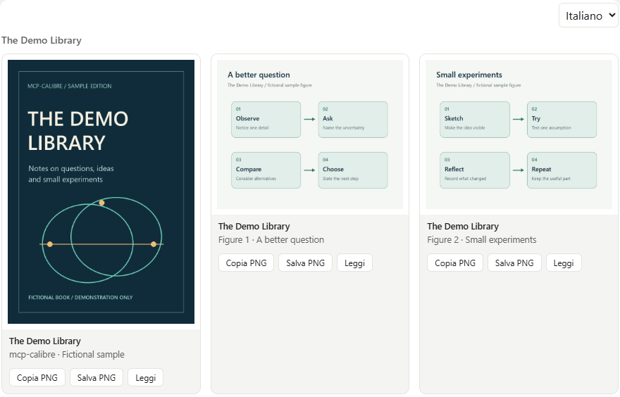
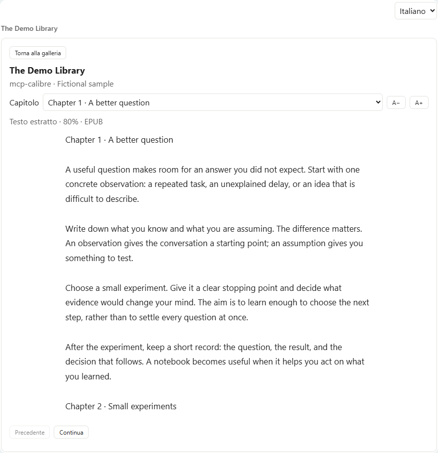
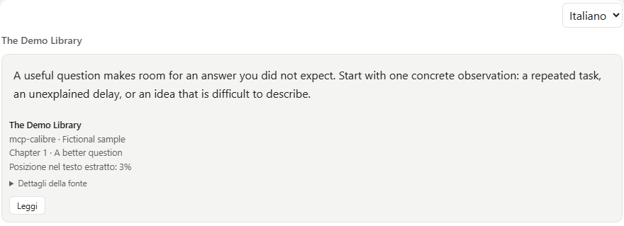

# Lettura e immagini nella chat

[← README](../../README.it.md) · [Installazione](installation.md) · [Personalizzazione](tweaking.md) · **Lettura e immagini** · [Skill](skills.md) · [FAQ](faq.md) · [Prestazioni](performance.md)

[🇬🇧 English](../en/reading-and-images.md) · 🇮🇹 Italiano

Consulta direttamente i tuoi libri nella conversazione: apri copertine e figure, osserva un diagramma,
leggi un capitolo o visualizza un passaggio esatto con la sua fonte. Questi controlli sono per l'utente.
L'assistente e le skill continuano a raccogliere informazioni con i normali tool di ricerca e lettura.

## Un giro rapido

1. Chiedi di vedere la copertina di un libro o una figura pertinente.
2. Clicca un'immagine per ingrandirla; usa Ctrl + rotella per osservarne i dettagli.
3. Premi **Leggi** per consultare il testo estratto, scegliere un capitolo e continuare a leggere.
4. Chiedi esplicitamente di visualizzare un passaggio esatto quando vuoi una citazione con la fonte.

Le immagini qui sotto sono rendering del vero `gallery.html` in un host MCP Apps simulato.
**The Demo Library**, copertina, figure e testo sono esempi fittizi creati per questa documentazione:
non rappresentano un libro pubblicato. Il client reale può avere una cornice diversa o limitare
appunti, download ed eventi di focus.

## Mostrare le immagini nella chat



Le immagini restituite da un normale tool MCP arrivano al modello, ma la maggior parte dei client le mostra
solo dentro il blocco ripiegato della chiamata al tool, e il modello non può riusarle nei file.
`calibre_show_images` mostra copertine e figure **all'utente, in linea nella conversazione**, usando
l'estensione ufficiale MCP Apps (SEP-1865):

- il tool dichiara un'interfaccia (`_meta.ui.resourceUri = ui://calibre-mcp/gallery`), una galleria HTML
  autonoma che il client visualizza in un riquadro isolato (sandbox) dentro la chat;
- le immagini viaggiano in `structuredContent`, che va alla galleria e **non nel contesto del modello**:
  mostrare immagini non costa token, e il modello riceve solo un breve riepilogo testuale;
- tutto resta in sola lettura: nessun file viene scritto, la galleria non ha accesso alla rete (le immagini
  sono URI `data:`, ammessi dalla CSP restrittiva predefinita della specifica) e nulla esce dalla macchina.

Esempio di richiesta all'assistente: "mostrami le copertine di 1168 e 1164", oppure "mostrami la figura s3-2
di 1164".

| Azione | Gesto |
|---|---|
| Alternare Adatta / 100% | Doppio clic sull'immagine oppure pulsanti |
| Zoomare dal 5% al 500% | Ctrl + rotella, con riferimento al punto sotto il cursore |
| Esplorare l'immagine ingrandita | Trascinamento oppure barre di scorrimento / frecce |
| Chiudere l'immagine | Esc, Chiudi oppure clic sullo sfondo |
| Tornare alla chat | Il clic nella chat chiude l'immagine quando il client comunica la perdita di focus |

**Copiare e salvare.** Ogni immagine ha due pulsanti, che producono entrambi un vero PNG (le sorgenti JPEG
vengono convertite nel browser), mentre il server continua a non scrivere nulla:

| Pulsante | Come | Dipende dal client |
|---|---|---|
| Copy PNG | Clipboard API (`image/png`); la galleria dichiara il permesso `clipboardWrite` della specifica | Se il client nega l'accesso agli appunti, ripiega sulla copia dell'immagine come selezione, che Word, PowerPoint, Outlook e la maggior parte degli editor incollano come immagine |
| Save PNG | Chiede al client di salvare il file (`ui/download-file`), quindi il download passa dal flusso del client | I client senza quella richiesta usano il download nativo del riquadro; se anche i download sono bloccati, la riga di stato lo segnala |

Anche trascinare un'immagine fuori dalla galleria verso un'altra applicazione funziona nella maggior parte dei client.

**Supporto dei client.** MCP Apps è supportato, tra gli altri, da Claude (web e desktop) e ChatGPT. Un client
senza supporto mostra solo il riepilogo: il riepilogo indica al modello di riprovare con
`also_for_model=true`, che allega anche piccole miniature per il modello (dentro il blocco del tool, con costo
in token immagine) così può descriverle. Sono stati segnalati problemi di visualizzazione su alcune build di
Claude Desktop per Windows; il fallback copre anche quel caso.

**Sicurezza della vista.** Didascalie e titoli provengono dai libri, quindi vengono inseriti come testo, mai
come HTML; vengono visualizzati solo dati PNG e JPEG (SVG e qualunque altro formato vengono scartati); la
galleria accetta messaggi solo dal riquadro padre e non carica nulla dall'esterno. Queste proprietà sono
verificate in un browser reale (`tests/test_gallery_browser.py`, `tests/test_gallery_copy_save.py`), con didascalie e payload ostili.

## Lettore in-place e lingua della vista



**Leggi** sulle immagini apre il testo del libro nella stessa vista. Sulle citazioni apre la lettura
dall'offset del passaggio, mantenendo formato e libreria. Il lettore offre scelta del capitolo,
Precedente/Continua, dimensione del testo e ritorno alla galleria. Carica un estratto alla volta:
è testo estratto, non la tipografia originale EPUB/PDF. La lettura non aggiorna il progresso in Calibre.

Il tool interno `calibre_read_view` è visibile solo all'app nei client che rispettano questa indicazione.
Il lettore è azionato dall'utente con Leggi; la LLM usa i normali tool di ricerca e lettura per risposte
azionabili e skill. La vista citazioni si usa su richiesta esplicita di visualizzare passaggi verbatim.
Sono modalità di consultazione diretta della libreria locale dell'utente, separate dal lavoro della LLM.
Il tool restituisce testo e capitoli in `_meta.calibreReader`, mentre la risposta al modello contiene solo
riferimenti. Il client deve supportare `tools/call` dalla vista e inoltrare `_meta`; altrimenti il
lettore mostra un errore con Riprova. Dopo l'aggiornamento riavvia il server e aggiorna la connessione MCP
per registrare il nuovo tool. Non servono nuove dipendenze.

La vista sceglie italiano o inglese dalla lingua del browser o dal locale del client, se comunicato.
Il selettore Italiano/English consente di cambiarla. La lingua dei libri rimane quella originale.

Le immagini hanno zoom Adatta/100%, doppio clic, Ctrl+rotella (5–500%), trascinamento e chiusura con
Esc o clic sullo sfondo. Quando il client comunica la perdita di focus, anche il clic nella chat chiude
l'immagine senza riprendere il focus. La griglia rimane invariata.

## Mostrare citazioni verbatim nella chat



`calibre_show_quotes` usa la stessa vista HTML isolata della galleria di immagini. Nei client con
supporto MCP Apps il passaggio compare inline nella conversazione, anziché come Markdown nel messaggio
dell'assistente o collegamento a un file HTML separato. Il server non scrive un file HTML per ogni citazione.

Trova il passaggio con `calibre_find_in_book`, `calibre_search_fulltext` o `calibre_search_semantic`, poi
passa il riferimento usando **lo stesso formato** del risultato della ricerca:

```json
{
  "passages": [{"book_id": 1168, "format": "EPUB", "offset": 1200, "max_chars": 424}],
  "title": "Passaggio selezionato",
  "library": "La mia libreria"
}
```

`title` e `library` sono facoltativi; ometti `library` per usare la libreria principale. ID e offset sono
esemplificativi: usa quelli restituiti dalla tua libreria. L'offset di ricerca identifica una corrispondenza,
non necessariamente l'inizio di una frase; scegli l'inizio e il numero di caratteri del passaggio desiderato.
Non inviare un campo `text`: il server legge la fonte e rifiuta i campi aggiuntivi nei riferimenti.

| Parametro | Significato |
|---|---|
| `passages` | 1–12 riferimenti; possono indicare libri diversi nella libreria selezionata |
| `book_id` | ID Calibre positivo, obbligatorio |
| `format` | Formato facoltativo; usa quello associato all'offset per evitare di selezionare un testo diverso |
| `offset` | Posizione del carattere nel testo estratto, a partire da zero; default `0` |
| `max_chars` | 1–6000 caratteri, default `1000`; limitato anche da `CALIBRE_MCP_MAX_CHARS` e dalla fine del testo |
| `title` | Titolo facoltativo della vista, massimo 200 caratteri |
| `library` | Nome facoltativo della libreria, da `calibre_list_libraries` |

**Esattezza e riferimenti.** Il testo viene prelevato direttamente dalla fonte estratta senza tagliare
parole, normalizzare spazi o aggiungere virgolette. La vista mostra titolo, autori, capitolo quando
identificabile e posizione percentuale nel testo estratto. Nei **Dettagli della fonte** conserva formato e
`[offset, end_offset)`; `end_offset` è escluso. Sono posizioni di caratteri, non numeri di pagina o indici
di sezioni EPUB. L'estrazione o l'OCR possono differire dalla tipografia originale. Una nuova estrazione,
la sostituzione del libro o il cambio di formato possono spostare gli offset: ripeti la ricerca anziché
riutilizzare un riferimento vecchio. Libro mancante, testo non disponibile o offset fuori intervallo fanno
fallire l'intera chiamata; non viene restituita una lista parziale di citazioni.

**Cosa arriva al modello.** Testo e attribuzione viaggiano in `_meta.calibreQuotes` del risultato,
destinato alla vista. `content` contiene un breve riepilogo; `structuredContent` contiene soltanto `count`
e riferimenti (`book_id`, `format`, `offset`, `end_offset`). Titoli, autori e passaggi vengono inseriti come
testo, mai come HTML eseguibile. Il client riceve comunque il testo per visualizzarlo: è una separazione
fra vista e modello, non una garanzia su log o archiviazione del client. Le ricerche e letture precedenti
potrebbero avere già restituito il passaggio al modello; questo tool non lo rimuove dalla cronologia.

**Aggiornamento e supporto del client.** Dopo l'aggiornamento riavvia il server e riconnetti il client
o aggiorna il suo elenco di tool MCP. Questa funzione non richiede nuove dipendenze Python,
reindicizzazione o migrazioni degli indici. Il client deve supportare MCP Apps e inoltrare `_meta` del
risultato in `ui/notifications/tool-result`. Senza MCP Apps resta solo il riepilogo; se i metadati vengono
rimossi, la vista HTML mostra un messaggio diagnostico. Le citazioni non hanno un'opzione `also_for_model`
e non vengono copiate automaticamente in chat. Aprire un file HTML nel browser non verifica questa
connessione MCP Apps.

**Verifica.** Esegui `python -m unittest discover -s tests -p test_quotes.py` e
`node tests/test_quotes_view.cjs` per estrazione, metadati e DOM. Gli scenari browser di
`tests/test_gallery_browser.py` coprono anche le citazioni (servono libreria fittizia, Playwright e Chromium,
come descritto nel test). Un'anteprima locale riuscita non conferma il supporto in tutti i client MCP.

## Rigenerare questi rendering

Dalla radice del repository esegui `python presentation/render_ux_demo.py --channel msedge`; usa `chrome`
per Chrome installato oppure ometti `--channel` per Chromium di Playwright. Servono Pillow e Playwright.
Lo script genera i sei screenshot italiano/inglese in `presentation/screenshots/`, creando copertina,
diagrammi e testo da zero. Usa un host simulato e non apre alcuna libreria Calibre.
